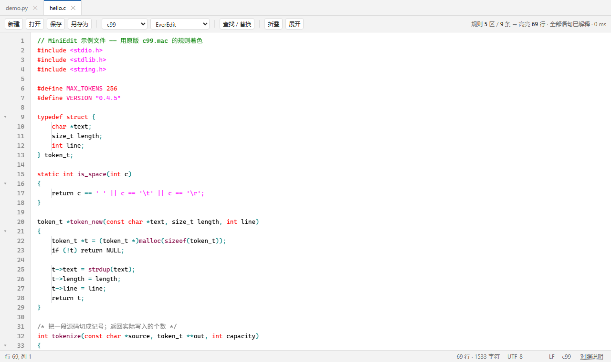

# MiniEdit 1.1.0

一个能装进 Windows 的代码编辑器。**高亮规则不写在程序里**——它直接解释 EverEdit 分发格式的
`syntax/*.mac` 与 `theme/*.ini`，所以"像不像"可以逐条数出来，不用靠肉眼比。



## 装与用

到 [Releases](../../releases/latest) 下载 `miniedit_1.1.0_setup.exe`，双击安装，可自选目录，装完自动启动。
安装后开始菜单和桌面会有 MiniEdit。第一次启动会打开两个示例文件，直接敲字就能编辑。

| 操作 | 快捷键 |
|---|---|
| 新建 / 打开 / 保存 / 另存为 | `Ctrl+N` / `Ctrl+O` / `Ctrl+S` / `Ctrl+Shift+S` |
| 关闭标签 / 切标签 | `Ctrl+W` / `Ctrl+Tab`（`Shift` 反向） |
| 查找 / 替换 / 转到行 | `Ctrl+F` / `Ctrl+H` / `Ctrl+G` |
| 字号 | `Ctrl+=` / `Ctrl+-` / `Ctrl+0` |
| 自动换行 / 全屏 | `Alt+Z` / `F11` |
| 折叠全部 / 展开全部 | `Ctrl+Shift+[` / `Ctrl+Shift+]`（或点行号栏的小三角） |
| 切换语言 | `Ctrl+L` 聚焦语言下拉 |

文件也可以直接拖进窗口。最近打开、窗口大小、主题、字号都会记住，存在
`%APPDATA%/MiniEdit/state.json`。

## 它凭什么"一样"

三个判断都落在可复核的数据上：

- **语法**：67 个独立语法 + 7 个片段文件，全部来自原版 `syntax/*.mac`；解释器完整加载 60 个，
  累计 53 条语句未支持。缺口在界面上点红色数字能看到具体行号与原因。
- **配色**：24 套 `theme/*.ini` 全部可用，每套的 token 颜色由 `const.mac` 的常量表映射生成。
- **行为开关**：`setting.ini` 读到 49 个键，行号、当前行、自动缩进、自动配对、Tab 宽度都按它走。
- **折叠**：50 个语法自带 `FoldText` / `IndentText` / `FoldingMethod` 声明，照声明折；
  其余 23 个按缩进兜底，界面上会标出来源。

## 结构

```
desktop/main.cjs      主进程：窗口、菜单、文件对话框、编码读写
desktop/preload.cjs   contextBridge，只暴露必要方法（sandbox 打开）
desktop/encoding.cjs  编码识别与写回（GBK 走 iconv-lite，UTF-16 手工拼 BOM）
desktop/reference.cjs 只读参考数据，把 syntax/theme 当配置读
js/core/mac.mjs       .mac 文件解释器（词法 + 中间表示）
js/core/highlight.mjs 逐行分词器（支持跨行区域与捕获组）
js/core/theme.mjs     theme/*.ini → CSS 变量与 token 类
js/core/fold.mjs      折叠区间（配对法 / 缩进法）
js/app.js             编辑器主体：标签、渲染、查找替换、文件操作
assets/reference/     随包分发的 syntax / theme / setting.ini
tools/verify.mjs      覆盖率统计，`npm run verify`
tools/fold-test.mjs   折叠区间的不变量检查，`npm run test:fold`
tools/crop-png.mjs    裁剪放大截图（只依赖 zlib），查像素细节用
```

数据在 asar 里只读，用户文件永远在外面读写，互不影响。

## 开发与打包

```bash
npm install
npm run serve     # 浏览器模式，http://127.0.0.1:5178
npm start         # 桌面模式（需要 electron）
npm run verify    # 打印每个语法文件的解释结果
npm run test:fold # 折叠区间的不变量检查
npm run dist      # 出安装包 → dist/miniedit_1.1.0_setup.exe
```

安装包不进仓库（约 117 MB），只挂在 Releases 上；`dist/` 已在 `.gitignore` 里。

打包机注意两条：

- 环境里有 `ELECTRON_RUN_AS_NODE=1` 时 electron 会被当成纯 Node 跑，启动前要 `env -u ELECTRON_RUN_AS_NODE`；
- 若上一次的产物目录已存在，electron-builder 会先批量删旧目录，某些环境的安全策略会拦下这一步。
  换个输出目录即可：`npx electron-builder --win nsis -c.directories.output=dist-build`。

（`dist/` 下只留安装包；`.build-cache/` 里是历次中间产物，可以直接删。）

### 自检

主进程内置一条无头自检链路（`MINIEDIT_SMOKE=<png 路径>` 启动），它会：

1. 经 IPC 写一个 GBK + CRLF 的中文文件，再读回来，比对编码、行尾、正文是否一致；
2. 点一下行号栏的三角，确认可见行数正好少了 `end-start` 行、三角变成 `▸`、状态栏出现"折叠 N 处"；
3. 再派发一次 `beforeinput`，确认折叠自动展开且正文与折叠前逐字一致（`restored: true`）；
4. 抓取界面状态（标签、规则数、主题数、语法数、缩进线数量）；
5. 截一张图后退出。

`npm run dist` 出来的包已用这条链路验证过：`SMOKE_IO ok=true`、24 套主题、67 个语法、
`SMOKE_FOLD removed=4 shrunk=true arrow="▸" restored=true`。

## 折叠是怎么做的

文本框（`<textarea>`）没法只隐藏其中几行，所以折叠做成**视图层**：`tab.text` 永远是正文，
折叠只决定"把哪几行放进文本框"。有三条约束保证它不会写坏文件：

- **正文只有一个来源**：保存、查找、编码转换全部读 `tab.text`，不读文本框里的内容；
- **一改文本就先展开**：`beforeinput` 与 `keydown` 在插入/删除前调用 `unfoldAll()`，
  光标按"视图偏移 → 真实偏移"映射回去，所以不存在"从折叠视图取正文"的路径；
- **折叠不带脏标记**：折叠/展开不改 `tab.text`，也不置 dirty。

折叠区间优先用语法文件自己的声明（`FoldText` + `UnfoldText` 配对法、`IndentText` /
`FoldingMethod="indent"` 缩进法），没声明才按缩进兜底——这条"来源"在界面上可见，
不是黑箱。

## 没做的，以及为什么

| 能力 | 状态 | 原因 |
|---|---|---|
| 十六进制视图 | 未实现 | 原版由 `hexedit.dll` 提供，二进制文件目前直接拒绝打开并提示 |
| 文件树侧栏 | 未实现 | 原版由 `shelltree.dll` 提供 |
| 宏 / `.esm` 模式 | 未实现 | 原版跑 JS 宏，需要另一套运行沙箱 |
| 大文件 | 部分 | 高亮上限 4000 行，超过部分按纯文本显示；打开上限 32MB |
| 文件关联 | 未做 | 安装器不抢 `.txt` 默认程序；需要时可右键"打开方式"选择 MiniEdit |

## 三个踩过的坑

- `CreateRegion` 第 4 个参数不是"是否跨行"，判据是结束符里是否含 `$`；
- `setting.ini` 是 UTF-16LE，`.mac` 里还有 GBK，编码要逐个判而不是统一按 UTF-8；
- 主题键名大小写与 `const.mac` 的常量名不一致，匹配时统一转小写。

## 数据来源

`syntax/` 与 `theme/` 取自 EverEdit 安装包（NSIS-2 + LZMA，7-Zip 可直接解开），
版权归原作者。本程序仅把它们当兼容性参考数据读取，不包含原版任何可执行代码。
